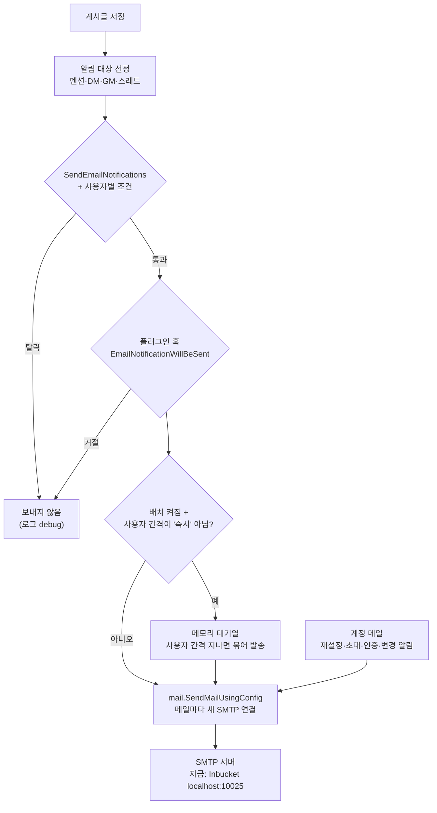

# 이메일 설정과 발송·수신 — 코드 분석

2026-11-03, `master`(d0bb91cdff) 기준. 본문의 동작 설명은 모두 코드에서 확인했고 각 항목에 근거 위치를 달았다. 코드 밖 정보(Gmail·SES·AWS 정책)는 "코드 밖 정보"로 따로 표시한다.

## 요약

- 지금 메일은 **실제 메일함에 도착하지 않는다.** 로컬 설정이 SMTP를 Inbucket(가짜 메일함, `localhost:10025`)으로 보내는데, 그 Inbucket조차 지금 떠 있지 않다.
- 실제로 받으려면 **SMTP 대상만 바꾸면 된다.** 코드 수정은 필요 없다. 로컬 확인은 Gmail 앱 비밀번호, 운영은 SES·Google 릴레이를 쓴다.
- 메일은 두 종류다. **알림 메일**(멘션·DM 등)은 수신 조건 여러 겹을 통과해야 나가고, **계정 메일**(비밀번호 재설정·초대 등)은 해당 기능이 호출되면 바로 나간다.
- 실패는 대부분 **화면에 안 보인다.** 알림 메일은 백그라운드에서 보내고 실패를 로그에만 남긴다. `SMTPServer`가 비어 있으면 로그조차 없다.
- 발송 코드는 upstream(Mattermost)과 같다. 포크가 바꾼 것은 한국어 번역과 로그 필드명뿐이다.

## 1. 실제 메일을 받으려면 무엇을 하나

### 지금 안 오는 이유

| 이유 | 근거 |
| --- | --- |
| SMTP가 Inbucket(`localhost:10025`)을 가리킨다. Inbucket은 받은 메일을 밖으로 전달하지 않는다 | `server/config/config.json` `EmailSettings` |
| 10025 포트에 아무것도 없다. WSL에 `docker` 명령이 없어(Docker Desktop WSL 연동 꺼짐) Inbucket이 안 떠 있다. 발송은 `unable to connect to the SMTP server`로 실패한다 | `/dev/tcp/127.0.0.1/10025` 접속 거부, 2026-11-03 확인 |
| 로컬은 `ServiceSettings.EnableEmailInvitations=false`라 팀·게스트 초대는 SMTP 전에 막힌다 | [team.go:1724](../server/channels/app/team.go#L1724) 외 3곳 |

### 방법 A — 로컬에서 내 Gmail로 받아 보기

개발자 확인용이다. 운영에는 쓰지 않는다.

1. Google 계정에 2단계 인증을 켜고 **보안 → 앱 비밀번호**에서 16자리 비밀번호를 만든다. 계정 비밀번호로는 인증되지 않는다(코드 밖 정보).
2. 서버를 띄울 셸에 아래 변수를 넣고 `make run-server`로 띄운다. `config.json`은 고치지 않는다. 환경 변수는 메모리에서만 덮어쓰고 파일·DB에 저장되지 않는다([environment.go:89](../server/config/environment.go#L89), [store.go:152](../server/config/store.go#L152)).
3. 관리자 계정의 이메일을 실제 받을 주소로 바꾼다. 연결 테스트 메일은 로그인한 관리자 본인 주소로 간다.
4. 시스템 콘솔 → 환경 → SMTP → **연결 테스트**를 누른다.

```bash
export MM_EMAILSETTINGS_SMTPSERVER=smtp.gmail.com
export MM_EMAILSETTINGS_SMTPPORT=587
export MM_EMAILSETTINGS_CONNECTIONSECURITY=STARTTLS
export MM_EMAILSETTINGS_ENABLESMTPAUTH=true
export MM_EMAILSETTINGS_SMTPUSERNAME=<내 Gmail 주소>
export MM_EMAILSETTINGS_SMTPPASSWORD=<앱 비밀번호 16자리>
export MM_EMAILSETTINGS_FEEDBACKEMAIL=<내 Gmail 주소>      # 봉투 발신자가 된다. 인증 계정과 같게
export MM_EMAILSETTINGS_FEEDBACKNAME="OKRBEST O'talk (dev)"
export MM_SERVICESETTINGS_ENABLEEMAILINVITATIONS=true       # 초대 메일까지 볼 때
```

개인 Gmail은 하루 발송 한도가 수백 통 수준이다(코드 밖 정보, 대략치). 확인이 끝나면 앱 비밀번호를 지운다.

### 방법 B — Inbucket으로 가짜 메일함 확인

실제 메일함에는 안 가지만 아무 주소로 보내 보며 내용·링크를 볼 수 있다. 지금 설정을 그대로 쓴다.

1. Docker Desktop → Settings → Resources → WSL integration에서 이 배포판을 켠다.
2. `cd server && make start-docker`로 Inbucket을 포함한 컨테이너를 띄운다.
3. 메일을 발생시킨 뒤 `http://localhost:9001`에서 받는 주소를 입력해 연다.

### 방법 C — 운영

5장 "운영 서버에 적용하는 절차"를 따른다. 방법 A와 다른 점은 서비스 전용 공급자, 우리 도메인의 발신 주소, SPF·DKIM, 실제 `SiteURL` 네 가지다.

### 받았는지 이 순서로 확인한다

1. **연결 테스트** — 접속·인증·전송을 한 번에 확인한다. 실패하면 화면에 `Connection unsuccessful: <오류>`가 뜬다. **저장된 설정으로 테스트한다.** 콘솔에서 값을 고쳤다면 먼저 저장한다(2-4절).
2. **비밀번호 재설정** — 로그인 화면에서 실제 가입된 이메일로 요청한다. 가입 안 된 주소는 "성공" 응답만 오고 메일은 안 간다(3-2절).
3. **멘션 알림** — 받는 사람을 로그아웃시켜 오프라인으로 두고, 다른 계정으로 `@아이디` 멘션이나 DM을 보낸다. 온라인이면 안 간다(3-1절).
4. 안 오면 서버 로그에서 `sending mail`(SMTP로 넘어갔다)과 `Unable to send notification email.`(실패했다)을 찾는다.

## 2. SMTP 발송은 코드에서 어떻게 일어나나



### 2-1. 설정이 SMTP 설정으로 바뀐다

`EmailSettings`는 발송 직전마다 `mail.SMTPConfig`로 옮겨진다([email/utils.go:11](../server/channels/app/email/utils.go#L11), 테스트용은 [app/config.go:331](../server/channels/app/config.go#L331)). 매번 현재 설정을 읽으므로 설정을 바꾸면 재시작 없이 다음 메일부터 적용된다.

| `SMTPConfig` 필드 | 출처 | 쓰이는 곳 |
| --- | --- | --- |
| `Server`, `ServerName` | `SMTPServer` | 접속 주소, TLS 인증서 이름 확인 |
| `Port` | `SMTPPort` | 접속 포트 |
| `Hostname` | `ServiceSettings.SiteURL`의 호스트 | EHLO 인사, Message-ID 도메인 |
| `ConnectionSecurity` | 같은 이름 | TLS / STARTTLS / 없음 |
| `EnableSMTPAuth`, `Username`, `Password` | 같은 이름 | SMTP AUTH |
| `ServerTimeout` | `SMTPServerTimeout` | TCP 접속(TLS면 핸드셰이크 포함)과 서버 첫 응답까지만 적용(초) |
| `FeedbackName`, `FeedbackEmail` | 같은 이름 | From 헤더, 봉투 발신자 |
| `ReplyToAddress` | 같은 이름(호출 측이 바꿀 수 있음) | Reply-To 헤더 |

### 2-2. 한 통을 보내는 8단계

모든 메일은 `mail.SendMailUsingConfig` → `sendMailUsingConfigAdvanced`로 모인다([mail.go:258](../server/platform/shared/mail/mail.go#L258)). 연결을 재사용하지 않고 **메일 한 통마다 연결을 새로 열고 닫는다.**

1. **서버 이름이 비면 그냥 끝난다** — `SMTPServer == ""`이면 오류 없이 `nil`을 돌려준다([mail.go:259](../server/platform/shared/mail/mail.go#L259)). 로그도 없어서 호출 측은 보낸 것으로 안다.
2. **접속한다** — `ConnectionSecurity=TLS`면 `tls.DialWithDialer`로 처음부터 암호화하고, 아니면 평문 TCP로 붙는다. 타임아웃은 `SMTPServerTimeout`초다([mail.go:118](../server/platform/shared/mail/mail.go#L118)).
3. **SMTP 세션을 연다** — `ServerTimeout` 안에 서버의 첫 응답(220)을 못 받으면 실패한다([mail.go:151](../server/platform/shared/mail/mail.go#L151)). 타임아웃은 여기까지다. 이후 EHLO·STARTTLS·AUTH·전송 단계에는 시간 제한이 없어서, 서버가 중간에 응답을 멈추면 그 발송은 계속 기다린다. 소켓에 deadline을 거는 코드가 `mail.go`에 없다.
4. **EHLO** — `Hostname`(SiteURL 호스트)으로 인사한다([mail.go:178](../server/platform/shared/mail/mail.go#L178)). SiteURL이 비면 이 호출을 건너뛰고, Go `net/smtp`가 기본값 `localhost`로 인사한다.
5. **STARTTLS** — `STARTTLS`면 TLS로 올린다. 이때 **반환 오류를 확인하지 않는다**([mail.go:189](../server/platform/shared/mail/mail.go#L189)). 실패해도 평문 연결로 계속 진행한다.
6. **인증** — `EnableSMTPAuth=true`면 서버가 PLAIN을 광고할 때 PLAIN, 아니면 LOGIN을 쓴다([mail.go:75](../server/platform/shared/mail/mail.go#L75)). LOGIN은 TLS가 아니면 `unencrypted connection`으로 거부한다. PLAIN도 Go 표준 라이브러리 규칙상 TLS나 localhost가 아니면 거부한다. 그래서 5번 STARTTLS가 조용히 실패하면 여기서 `unencrypted connection`이 난다.
7. **메시지를 만든다** — go-mail로 만든다([mail.go:308](../server/platform/shared/mail/mail.go#L308)).
    - From `FeedbackName <FeedbackEmail>`, Reply-To `FeedbackName <ReplyToAddress>`(주소가 있을 때만)
    - To·Cc는 주소 **하나**만 받는다. 여러 개면 `invalid To header: must contain exactly one address`
    - `Message-ID: <16자 난수-유닉스시각@Hostname>`([mail.go:355](../server/platform/shared/mail/mail.go#L355)), `Auto-Submitted: auto-generated`, `Precedence: bulk`, `Content-Transfer-Encoding: 8bit`
    - 본문은 HTML과, HTML에서 변환한 텍스트 두 벌이다. 알림 메일은 보낸 사람 프로필 사진을 `user-avatar.png`로 본문에 넣는다
8. **전송한다** — 봉투 발신자(`MAIL FROM`)는 `FeedbackEmail`이다. 비어 있으면 빈 발신자 `<>`로 나가 대부분의 서버가 거부한다.

### 2-3. 설정을 저장할 때 거부되는 값

설정 저장(콘솔·mmctl·API)은 아래 검증을 통과해야 한다([config.go:4849](../server/public/model/config.go#L4849), [config.go:4441-4445](../server/public/model/config.go#L4441-L4445)).

| 조건 | 결과 |
| --- | --- |
| `ConnectionSecurity`가 `""`·`TLS`·`STARTTLS`·`PLAIN` 외의 값 | 저장 거부 |
| `FeedbackEmail`·`ReplyToAddress`가 비어 있지 않은데 이메일 형식이 아님 | 저장 거부 |
| `SMTPPort`가 올바른 포트 문자열이 아님 | 저장 거부 |
| `EmailBatchingInterval < 30` 또는 `EmailBatchingBufferSize <= 0` | 저장 거부 |
| `EmailNotificationContentsType`이 `full`·`generic` 외의 값 | 저장 거부 |
| 배치를 켰는데 `ServiceSettings.SiteURL`이 비어 있음 | 저장 거부 |
| 배치를 켰는데 클러스터 모드(`ClusterSettings.Enable`) | 저장 거부 |

`SMTPServer`가 비어 있는 것은 검증하지 않는다. 그래서 2-2절 1번처럼 조용히 아무것도 안 보내는 상태가 될 수 있다.

### 2-4. 연결 테스트 버튼은 무엇을 하나

콘솔 **환경 → SMTP → 연결 테스트**는 `testSmtp` 액션이 `POST /api/v4/email/test`를 **본문 없이** 호출한다([admin_actions.ts:500](../webapp/channels/src/actions/admin_actions.ts#L500)). 서버는 본문이 없으면 현재 설정을 쓰고([system.go:244](../server/channels/api4/system.go#L244)), `TestEmail`은 `SMTPServer`가 비었는지 확인한 뒤 **현재 설정(저장값 + 환경 변수)**으로 테스트 메일을 보낸다([admin.go:194](../server/channels/app/admin.go#L194)).

- 콘솔에서 고치고 저장하지 않은 값은 테스트되지 않는다. **저장한 뒤 누른다.**
- 받는 사람은 버튼을 누른 관리자 본인의 이메일이다. 제목·본문은 그 관리자의 언어로 나간다.
- 성공 메시지는 "전송 중 오류가 없었다"는 뜻일 뿐이다. 메일함에 실제로 왔는지는 따로 본다.

## 3. 메일 종류별로 언제 나가나

### 3-1. 알림 메일(멘션·DM)

`SendNotifications`([notification.go:45](../server/channels/app/notification.go#L45))가 게시글마다 수신자를 고르고, 한 사람씩 조건을 거른 뒤 백그라운드에서 보낸다.

**누가 대상이 되나** — `getExplicitMentionsAndKeywords`([notification.go:1137](../server/channels/app/notification.go#L1137)):

| 채널·상황 | 대상 |
| --- | --- |
| DM | 상대방 |
| 그룹 메시지(GM) | 보낸 사람을 뺀 전원 |
| 일반 채널 | `@아이디`, 사용자 지정 키워드, 허용된 경우 `@channel`·`@all`·`@here`, 사용자 그룹 멘션으로 불린 사람 |
| 채널에 추가됨 | 추가된 사람 |
| 스레드 답글(CRT 꺼진 사용자) | 댓글 알림 설정이 "모든 스레드" 또는 "내가 시작한 스레드"인 참여자 |
| 스레드 답글(CRT 켜진 사용자) | 스레드 팔로워 중 이메일이 켜져 있고, 멘션됐거나 "스레드 답글 메일"이 `all`인 사람([notification.go:1783](../server/channels/app/notification.go#L1783)) |

보낸 사람 본인은 빠진다(웹훅 글은 예외). 사용자 기본값은 이메일 알림 `true`, 스레드 답글 메일 `all`이다([user.go:603-613](../server/public/model/user.go#L603-L613)).

**대상 중에서 걸러지는 순서:**

1. 알림 억제 글이면 처음부터 건너뛴다([notification.go:59](../server/channels/app/notification.go#L59)).
2. `SendEmailNotifications=false`면 알림 메일 전체를 건너뛴다([notification.go:468](../server/channels/app/notification.go#L468)).
3. `RequireEmailVerification=true`인데 이메일 미인증이면 뺀다([notification.go:492](../server/channels/app/notification.go#L492)).
4. `userAllowsEmail`([notification.go:1238](../server/channels/app/notification.go#L1238))이 아래를 모두 확인한다.
    - 봇·원격(공유 채널) 사용자가 아니다
    - 접근 제어 팀 멤버십 알림 글이 아니다
    - 사용자 이메일 알림이 `false`가 아니다. 채널별 설정이 기본값이 아니면 채널 설정을 따른다. 단 CRT 사용자의 스레드 답글은 채널 설정을 무시한다
    - 채널을 음소거(`mark_unread=mention`)하지 않았다
    - 상태가 **온라인·방해 금지가 아니다**(자리 비움·오프라인만 받는다). 상태 조회가 실패하면 오프라인으로 본다
    - 부재 중(Out of Office) 상태가 아니고 자동 응답 글이 아니다. 비활성(삭제) 계정이 아니다
5. 플러그인이 `EmailNotificationWillBeSent` 훅에서 거절하면 안 보낸다. 내용을 바꿀 수도 있다([notification_email.go:144](../server/channels/app/notification_email.go#L144)).
6. 배치 여부를 정한다(아래). 배치가 아니면 즉시 보낸다.

보내는 일은 `a.Srv().Go`로 백그라운드에서 한다. SMTP가 실패해도 글 쓰기는 성공하고, 실패는 `Unable to send notification email.` 경고 로그로만 남는다.

메일 본문 노출 수준(`EmailNotificationContentsType=generic`)은 라이선스의 `EmailNotificationContents` 기능이 있을 때만 적용된다. 라이선스가 없으면 설정값과 상관없이 항상 `full`이다([notification_email.go:52-54](../server/channels/app/notification_email.go#L52-L54)).

**배치 발송(`EnableEmailBatching=true`)의 실제 동작** — [email_batching.go](../server/channels/app/email/email_batching.go):

- 사용자가 고른 간격이 "즉시"(값 `30`)면 배치하지 않고 바로 보낸다. 간격 설정이 없는 사용자는 배치 대상이고 기본 간격은 15분(900초)이다([notification_email.go:213](../server/channels/app/notification_email.go#L213), [preference.go:119-125](../server/public/model/preference.go#L119-L125)).
- 대기열은 **서버 메모리**에만 있다. 크기는 `EmailBatchingBufferSize`(기본 256)이고, 가득 차면 즉시 발송으로 넘어간다([email_batching.go:53](../server/channels/app/email/email_batching.go#L53)). 서버를 재시작하면 대기 중이던 알림은 사라진다.
- `EmailBatchingInterval`(기본 30초)마다 확인한다. 사용자의 가장 오래된 알림이 그 사람의 간격보다 오래되면 모아서 한 통으로 보낸다([email_batching.go:162](../server/channels/app/email/email_batching.go#L162)).
- 그 사이 사용자가 해당 팀의 채널을 하나라도 열어 봤으면 묶인 알림을 버리고 보내지 않는다.

**사용자 화면** — 계정 설정 → 알림 → 이메일 알림. 배치가 켜져 있으면 즉시·15분·1시간·받지 않음, 꺼져 있으면 즉시·받지 않음만 보인다([email_notification_setting.tsx](../webapp/channels/src/components/user_settings/notifications/email_notification_setting/email_notification_setting.tsx)). `SendEmailNotifications=false`면 선택지 대신 관리자가 이메일 알림을 껐다는 안내만 보인다.

### 3-2. 계정·초대 메일

알림 메일의 조건(상태·음소거 등)과 무관하다. 기능별로 따로 막는 조건이 있다.

| 메일 | 언제 | 막는 조건 | 근거 |
| --- | --- | --- | --- |
| 가입 환영·이메일 인증 | 계정 생성 | `SendEmailNotifications`와 `RequireEmailVerification`이 **둘 다** `false`면 안 보냄 | [email.go:186](../server/channels/app/email/email.go#L186), [user.go:266](../server/channels/app/user.go#L266) |
| 비밀번호 재설정 | 로그인 화면 요청 | 아래 표 | [user.go:1917](../server/channels/app/user.go#L1917) |
| 팀 초대·게스트 초대 | 초대 보내기 | `ServiceSettings.EnableEmailInvitations=false`, 보낸 사람당 발송량 제한 | [team.go:1724](../server/channels/app/team.go#L1724), [service.go:106](../server/channels/app/email/service.go#L106) |
| `/invite_people` 명령 | 슬래시 명령 | 위 조건 + `SendEmailNotifications`·`TeamSettings.EnableUserCreation` | [command_invite_people.go:32](../server/channels/app/slashcommands/command_invite_people.go#L32) |
| 이메일·비밀번호·MFA·로그인 방식 변경, 비활성화, 액세스 토큰 | 해당 변경 시 | 따로 없음(SMTP 설정만) | `email.go`의 `Send*Email` |
| 플러그인이 보내는 메일 | `SendMail` 플러그인 API | `SendEmailNotifications=false` | [email.go:917](../server/channels/app/email/email.go#L917) |

비밀번호 재설정 응답은 경우마다 다르다([user.go:1917](../server/channels/app/user.go#L1917), [api4/user.go:2097](../server/channels/api4/user.go#L2097)).

| 요청 주소 | 메일 | 화면 응답 |
| --- | --- | --- |
| 가입된 일반 계정 | 보냄 | 성공 |
| 가입 안 된 주소 | 안 보냄 | **성공**(계정 존재 여부를 숨긴다) |
| SSO 계정, 원격 사용자, 매직 링크 게스트 | 안 보냄 | 오류(400). `EnableHardenedMode`면 성공으로 감춤 |
| SMTP 실패 | 실패 | 오류(500). `EnableHardenedMode`면 성공으로 감춤 |

초대 발송량 제한은 보낸 사람 ID 기준이다. 평균 시간당 20통이고 한 번에 20통까지 몰아서 허용한다(GCRA 방식, 상수는 [service.go:27-29](../server/channels/app/email/service.go#L27-L29)). 게스트 매직 링크 자가 요청은 받는 주소 기준 분당 60통이다. 이 제한은 서버 메모리에 있어 재시작하면 초기화된다.

`SendEmailNotifications=false`여도 게스트 초대 메일은 나간다. 대신 초대 링크를 서버 로그(`sending invitation`)에 남긴다([email.go:615](../server/channels/app/email/email.go#L615)). SMTP 없이 개발할 때 로그에서 링크를 꺼내 쓸 수 있다.

## 4. SMTP 설정 방법

### 4-1. 설정을 넣는 네 가지 방법

| 방법 | 형식 | 특징 |
| --- | --- | --- |
| 환경 변수 | `MM_EMAILSETTINGS_<키 대문자>` 예: `MM_EMAILSETTINGS_SMTPSERVER` | 가장 우선한다. 메모리에서만 덮어쓰고 저장되지 않는다. 콘솔의 해당 칸은 비활성화되고 "이 설정은 환경변수를 통해 설정되었습니다"가 뜬다 |
| 시스템 콘솔 | **환경 → SMTP**(서버·포트·보안·인증·테스트), **사이트 설정 → 알림**(알림 스위치·배치·발신자) | 저장하면 config 저장소(파일 또는 DB)에 들어간다 |
| `config.json` | `EmailSettings` 블록. `MM_CONFIG`가 DB면 DB에 있다 | 파일로 관리할 때 |
| mmctl | `mmctl config set EmailSettings.SMTPServer <값>` | 한두 값을 바꿀 때 |

환경 변수 처리는 [environment.go](../server/config/environment.go), 콘솔 잠금은 [schema_admin_settings.tsx:1668](../webapp/channels/src/components/admin_console/schema_admin_settings.tsx#L1668)에 있다.

### 4-2. 현재 로컬 값과 운영 권장값

| 키 | 로컬 현재 값 | 운영 권장값 | 비고 |
| --- | --- | --- | --- |
| `SMTPServer` | `localhost` | 공급자 호스트 이름 | TLS 인증서 이름과 같아야 한다(2-1절) |
| `SMTPPort` | `"10025"` | `"465"` 또는 `"587"` | 문자열 |
| `ConnectionSecurity` | `""` | 465면 `TLS`, 587이면 `STARTTLS` | |
| `EnableSMTPAuth` | `false` | `true` | IP 허용 릴레이만 `false` |
| `SMTPUsername`·`SMTPPassword` | 빈 값 | 서비스 전용 자격증명 | 비밀번호는 환경 변수·시크릿으로 |
| `SMTPServerTimeout` | `10` | `10`, 느린 망이면 20~30 | **콘솔에 없다.** 환경 변수·config로만 바꾼다. 접속과 첫 응답까지만 적용(2-2절 3번) |
| `SkipServerCertificateVerification` | `false` | `false` | `true`는 진단 때만 |
| `FeedbackName` | 빈 값 | 예: `OKRBEST O'talk` | 받은편지함에 보이는 이름 |
| `FeedbackEmail` | `test@example.com` | 예: `noreply@<우리 도메인>` | From·봉투 발신자. SPF·DKIM 도메인과 맞춘다 |
| `ReplyToAddress` | `test@example.com` | `noreply@…` 또는 지원 메일함 | |
| `SendEmailNotifications` | `true` | `true` | 알림·플러그인 메일 스위치(3장) |
| `EnableEmailBatching` | `false` | `true` 검토 | SiteURL 필수, 클러스터 불가, 재시작 시 대기분 유실 |
| `RequireEmailVerification` | `false` | `true` 검토 | 켜면 미인증 사용자는 알림 메일도 못 받는다 |
| `ServiceSettings.SiteURL` | `http://localhost:8065` | `https://<운영 도메인>` | 메일 속 링크, EHLO, Message-ID |
| `ServiceSettings.EnableEmailInvitations` | `false` | 초대를 쓰면 `true` | |

### 4-3. 포트와 연결 보안

| 포트 | `ConnectionSecurity` | 코드 동작 |
| --- | --- | --- |
| 465 | `TLS` | 접속부터 TLS(`tls.DialWithDialer`) |
| 587 | `STARTTLS` | 평문 접속 후 `STARTTLS`. 실패해도 오류 없이 평문으로 계속 |
| 25 | `""` | 평문. 인증을 켜면 `unencrypted connection`으로 실패. 같은 망의 사내 릴레이에만 쓴다. AWS EC2는 25번 아웃바운드를 기본으로 막는다(코드 밖 정보) |

`ConnectionSecurity=PLAIN`은 검증을 통과하지만 SMTP 코드는 `TLS`·`STARTTLS`만 구분하므로 "없음"과 똑같이 동작한다.

## 5. 운영 서버에 적용하는 절차

운영 설정은 이 저장소가 아니라 배포 저장소(okrbest-deploy)에 둔다([REBRAND.md](../REBRAND.md) 1단계).

### 5-1. 공급자를 고른다(코드 밖 정보)

| 공급자 | `SMTPServer` | 포트 · 보안 | 인증 | 맞는 경우 |
| --- | --- | --- | --- | --- |
| AWS SES(서울) | `email-smtp.ap-northeast-2.amazonaws.com` | 465 · TLS (587 · STARTTLS도 가능) | SES SMTP 자격증명 | AWS에서 운영하고 반송률을 보고 싶을 때 |
| Google Workspace 릴레이 | `smtp-relay.gmail.com` | 587 · STARTTLS | SMTP AUTH 또는 공인 IP 허용 | 회사 메일이 Google Workspace일 때 |
| 사내 Postfix 릴레이 | 릴레이 호스트 | 25 · 없음 또는 587 · STARTTLS | IP 허용 | 중계 서버가 이미 있을 때 |

개인 Gmail 계정은 운영에 쓰지 않는다. 한도가 낮고 담당자가 바뀌면 끊긴다.

### 5-2. 발신 도메인 DNS(코드 밖 정보)

- **SPF**: 도메인 TXT에 공급자를 넣는다. SES는 `include:amazonses.com`, Google은 `include:_spf.google.com`.
- **DKIM**: 공급자 콘솔이 주는 CNAME·TXT를 등록한다. SES는 Easy DKIM CNAME 3개.
- **DMARC**: `_dmarc.<도메인>`에 `v=DMARC1; p=none; rua=mailto:…`로 시작하고 보고서를 본 뒤 `quarantine`으로 올린다.

### 5-3. 자격증명(코드 밖 정보)

- SES: **SMTP settings → Create SMTP credentials**. IAM 로그인 비밀번호와 다르다. 새 계정은 샌드박스라 검증된 주소로만 보내지므로 **프로덕션 액세스**를 요청한다.
- Google: 관리 콘솔 **앱 → Google Workspace → Gmail → 라우팅 → SMTP 릴레이 서비스**에서 허용 발신자 "내 도메인의 주소만", TLS 필수로 규칙을 만든다.

### 5-4. 배포 환경 변수

```bash
MM_EMAILSETTINGS_SMTPSERVER=email-smtp.ap-northeast-2.amazonaws.com
MM_EMAILSETTINGS_SMTPPORT=465
MM_EMAILSETTINGS_CONNECTIONSECURITY=TLS
MM_EMAILSETTINGS_ENABLESMTPAUTH=true
MM_EMAILSETTINGS_SMTPUSERNAME=<SES SMTP 사용자>
MM_EMAILSETTINGS_SMTPPASSWORD=<SES SMTP 비밀번호>     # 시크릿으로 주입
MM_EMAILSETTINGS_SKIPSERVERCERTIFICATEVERIFICATION=false
MM_EMAILSETTINGS_FEEDBACKNAME="OKRBEST O'talk"
MM_EMAILSETTINGS_FEEDBACKEMAIL=noreply@<우리 도메인>
MM_EMAILSETTINGS_REPLYTOADDRESS=noreply@<우리 도메인>
MM_EMAILSETTINGS_SENDEMAILNOTIFICATIONS=true
MM_EMAILSETTINGS_ENABLEEMAILBATCHING=true             # 단일 서버일 때만
MM_SERVICESETTINGS_SITEURL=https://<운영 도메인>
MM_SERVICESETTINGS_ENABLEEMAILINVITATIONS=true
```

Google 릴레이면 서버 `smtp-relay.gmail.com`, 포트 `587`, 보안 `STARTTLS`로 바꾼다. IP 허용 방식이면 `ENABLESMTPAUTH=false`에 사용자·비밀번호를 비운다.

### 5-5. 적용과 확인

1. 환경 변수는 서버 시작 때 읽으므로 서버(컨테이너)를 다시 띄운다.
2. 콘솔 **환경 → SMTP**에서 값이 회색으로 잠겨 보이는지 확인한다. 잠겨 있으면 환경 변수가 적용된 것이다.
3. 관리자 이메일을 실제 주소로 두고 **연결 테스트**를 누른다.
4. 받은 메일 원문(헤더)에서 `spf=pass`, `dkim=pass`, `dmarc=pass`를 확인한다.
5. 실제 시나리오를 확인한다.

- [ ] 비밀번호 재설정 메일이 온다
- [ ] 팀 초대 메일이 오고 링크가 운영 도메인을 가리킨다
- [ ] 받는 사람을 오프라인으로 두고 멘션·DM하면 알림 메일이 온다
- [ ] 배치를 켰다면 15분 안의 멘션 여러 건이 한 통으로 묶인다
- [ ] 외부 메일함(Gmail·네이버 등)에서 스팸함이 아닌 받은편지함에 들어간다

## 6. 안 될 때 보는 곳

오류는 연결 테스트 화면과 **시스템 콘솔 → 서버 로그**에 남는다. 앞쪽 문구는 [mail.go](../server/platform/shared/mail/mail.go)가 붙이고, 뒤쪽은 SMTP 서버의 응답이다.

| 오류·증상 | 코드상 원인 | 조치 |
| --- | --- | --- |
| 연결 테스트가 `SMTPServer` 누락 오류 | `TestEmail`의 빈 서버 확인 | `SMTPServer`를 넣는다 |
| 오류도 없고 메일도 없음, 로그에 `sending mail`도 없음 | `SMTPServer`가 비어 조용히 종료(2-2절 1번), 또는 수신 조건 탈락 | 설정 확인 → 3-1절 조건 확인 |
| `unable to connect to the SMTP server` + timeout | TCP 접속 실패 | 서버에서 `nc -vz <호스트> <포트>`, 방화벽·보안 그룹 |
| `unable to connect to the SMTP server through TLS` | TLS 핸드셰이크 실패. 587에 `TLS`를 쓴 경우가 흔하다 | 465·TLS 또는 587·STARTTLS로 맞춘다 |
| `authentication failed: unencrypted connection` | 평문 연결에서 인증 시도. 보안 "없음"이거나 STARTTLS가 조용히 실패 | 보안을 TLS 계열로. 그래도 나면 중간 장비가 STARTTLS를 막는지 본다 |
| `authentication failed: 535 …` | 자격증명 거부 | SES는 SMTP 자격증명(IAM 비밀번호 아님)과 리전을 확인 |
| `x509: certificate …` | 인증서 이름·체인 불일치 | `SMTPServer`를 인증서의 이름으로. 사내 CA면 신뢰 저장소에 추가 |
| `failed to set the from address` + `5xx` | 서버가 봉투 발신자(`FeedbackEmail`)를 거부 | 공급자가 허용한 발신 주소인지 확인 |
| `554 Message rejected: Email address is not verified`(SES) | SES 샌드박스이거나 발신 주소·도메인 미검증. 응답 단계는 SES가 정한다(코드 밖 정보) | 도메인 검증, 프로덕션 액세스 요청 |
| `failed to set the to address` + `550` | 릴레이 거부 | Google 규칙의 IP·발신자, 사내 릴레이 허용 범위 |
| `invalid To header: must contain exactly one address` | 주소에 쉼표 등 여러 주소 | 사용자 이메일 값 확인 |
| 테스트는 되는데 알림만 안 옴 | 3-1절 조건 탈락, 또는 배치 대기 중·채널을 열어 봐서 폐기 | 받는 사람 상태·설정 확인, 배치 끄고 재시도 |
| 스팸함으로 감 | SPF·DKIM·DMARC 실패, EHLO·Message-ID가 `localhost` | DNS 설정, `SiteURL`을 실제 도메인으로 |

공급자별 상세(Google 릴레이 허용 발신자 옵션, 발송 한도, Postfix 예시)는 [mattermost-smtp-email-notification-guide.md](mattermost-smtp-email-notification-guide.md)에 있다.

## 7. 포크가 바꾼 것

발송 로직은 바꾸지 않았다. `server/channels/app/email/`, `server/platform/shared/mail/`의 포크 커밋은 로그 필드명 정리(ef815f805a)와 한국어 번역(51b59cc24d)뿐이다.

- 메일 제목·본문은 받는 사람의 언어 설정으로 `server/i18n/ko.json`에서 나간다.
- 템플릿은 `server/templates/*.html`(mjml에서 생성)이고 로고·푸터는 Mattermost 기본값이다.
- upstream이 지운 Cloud 전용 템플릿(`cloud_*`, `payment_failed_*` 등)이 아직 남아 있다. Cloud 기능을 안 쓰므로 발송되지 않는다.

## 8. 메일에 보이는 브랜드는 어디서 오나

메일 25종이 공통으로 `NewEmailTemplateData`를 써서 푸터·조직명을 채운다([email.go:861](../server/channels/app/email/email.go#L861)). 알림 메일도 같은 함수를 쓴다([notification_email.go:377](../server/channels/app/notification_email.go#L377)).

| 보이는 곳 | 출처 | 지금 상태 |
| --- | --- | --- |
| 발신자 이름 | `FeedbackName` | 비어 있음 → 주소만 보인다 |
| 제목·본문의 서비스 이름 | i18n 문구의 `{{.SiteName}}` → `TeamSettings.SiteName` | 이메일 관련 문구 157개 중 27개가 SiteName을 쓴다 |
| 푸터 저작권 줄 | i18n `api.templates.email_footer_v2` | **Mattermost, Inc.와 팔로알토 주소가 문구에 박혀 있다.** SiteName을 바꿔도 안 바뀐다 |
| 푸터 조직명 | `FeedbackOrganization`이 있으면 "발신: <조직명>" | 비어 있음 → 안 보인다 |
| 로고 이미지 | `{{.Props.SiteURL}}/static/images/logo_email_dark.png`(템플릿 15곳), `logo-email.png`(6곳) | 받는 쪽 메일 앱이 **SiteURL에서 이미지를 내려받는다.** SiteURL이 `localhost`면 외부 메일함에서 로고가 깨진다 |
| 템플릿 HTML에 직접 쓴 "Mattermost" | `server/templates/*.html` | `unsupported_desktop_app.html` 1개뿐이다(메일이 아니라 브라우저 안내 페이지) |

O'talk로 바꾸려면 `FeedbackName`·`FeedbackOrganization`을 채우고, `email_footer_v2` 문구를 고치고, `logo_email_*` 이미지를 바꾸고, `SiteURL`을 외부에서 열리는 주소로 둔다.

## 9. 기존 문서는 코드와 맞나

이메일을 다루는 기존 문서 세 개를 코드와 대조했다.

### 9-1. mattermost-smtp-email-notification-guide.md

[mattermost-smtp-email-notification-guide.md](mattermost-smtp-email-notification-guide.md)는 운영 가이드다. 공급자별 절차(Google 릴레이·SES)가 자세하고, 코드 근거도 대부분 맞다. 아래는 코드와 다르거나 빠진 부분이다.

| 가이드 위치 | 가이드 서술 | 코드 확인 결과 |
| --- | --- | --- |
| 3-2 `SMTPServerTimeout` | "Environment > SMTP" 항목, "연결/처리 타임아웃" | **콘솔에 없다.** 접속과 서버 첫 응답까지만 적용되고 전송 단계에는 제한이 없다(2-2절 3번) |
| 3-2 `ConnectionSecurity` | 값은 `""`·`TLS`·`STARTTLS` | `PLAIN`도 저장되지만 "없음"과 같이 동작한다(4-3절) |
| 3-2·6-2 STARTTLS | 평문 후 TLS 업그레이드 | 업그레이드 실패를 무시하고 평문으로 계속한다. 이후 인증이 `unencrypted connection`으로 실패한다(2-2절 5·6번) |
| 6-3 인증 | "보안 연결 없는 인증은 서버 정책상 실패 가능성이 큽니다" | 서버가 아니라 **클라이언트 코드가 항상 거부한다**(localhost PLAIN 제외) |
| 3-3 `EmailNotificationContentsType` | `generic`이면 축약 정보 | 라이선스(`EmailNotificationContents`)가 없으면 콘솔에서 숨겨지고 항상 `full`이다 |
| 3-3 `SendEmailNotifications` | 포스트 알림 on/off | 맞다. 그 밖에 플러그인 메일·`/invite_people`도 막고, `RequireEmailVerification`과 둘 다 꺼지면 환영·인증 메일도 막는다(3-2절) |
| 2-2 마이그레이션 | "신규 공급자 설정을 병렬 준비 후 `Test Connection` 선검증" | 연결 테스트는 **저장된 설정**만 쓴다. 병렬 검증은 별도 서버나 스테이징에서 해야 한다(2-4절) |
| 5-2 개발 환경 | 재설정·인증 플로우를 보려면 "실제 SMTP 연동 필요" | Inbucket으로 충분하다(1장 방법 B). 실제 메일함이 필요할 때만 방법 A |
| 7-8·8 EHLO/HELO | "EHLO/HELO에 조직 도메인을 명시" 권장 | Mattermost에는 EHLO 설정이 따로 없다. **`SiteURL` 호스트가 EHLO가 된다.** Postfix의 `smtp_helo_name`은 Postfix 자신에만 적용된다 |
| 7-7 송신 한도 | 트랜잭션당 수신자 100명 제한 | 코드는 메일마다 수신자 1명, 연결 1개를 쓴다. 한도는 "메일 수"로 계산하면 된다 |
| 7-8 null envelope | `MAIL FROM: <>` 제약 | 봉투 발신자는 `FeedbackEmail`이다. 이 값이 비었을 때만 `<>`가 된다 |
| 14 SMTP 런타임 매핑 | `server/channels/app/config.go` | 그 파일의 함수는 연결 테스트용이다. 실제 메일은 `server/channels/app/email/utils.go`의 `mailServiceConfig`를 쓴다 |
| 3-1 가입·로그인 4개 설정 | `IsUserSignUpAllowed`, `GetUserForLogin` 등 | 맞다([user.go:310](../server/channels/app/user.go#L310), [login.go:98](../server/channels/app/login.go#L98), 미인증 로그인 거부는 [authentication.go:354](../server/channels/app/authentication.go#L354)) |

이 가이드에만 있고 이 문서에 옮기지 않은 내용은 그대로 가이드를 본다. Google 릴레이 허용 발신자·인증 옵션 비교(7-3·7-4), 발송 한도(7-7), Postfix 예시(8), Docker 네트워크 `mynetworks`(9-6), 공급자별 점검표(13)가 그렇다.

### 9-2. DEVELOPMENT.md

| 위치 | 서술 | 코드 확인 결과 |
| --- | --- | --- |
| 주요 서비스 표 | inbucket `http://localhost:9001` | 맞다(`server/build/docker-compose.common.yml`) |
| "이메일 테스트 (Inbucket)" | `MM_EMAILSETTINGS_SMTPSERVER=localhost`, `SMTPPORT=10025`, 인증 끔 | 맞다. 로컬 `config.json`과 같은 값이다. 다만 Inbucket을 띄우는 방법(`make start-docker`)과 WSL의 Docker 연동 조건은 적혀 있지 않다 |

### 9-3. REBRAND.md

| 위치 | 서술 | 코드 확인 결과 |
| --- | --- | --- |
| 1단계 | `FeedbackName/FeedbackEmail/FeedbackOrganization`으로 발신자 표시 | 맞다. `FeedbackOrganization`은 푸터의 "발신: …"로 나간다 |
| 4단계 | 템플릿은 대부분 `{{.SiteName}}` 변수를 써서 설정만으로 해결된다 | 템플릿 HTML은 `{{.Props.*}}`만 쓰고, SiteName은 i18n 문구 안에서 들어간다(157개 중 27개). **푸터 문구 `email_footer_v2`에는 Mattermost, Inc.가 박혀 있어** 설정만으로 안 바뀐다 |
| 4단계 | 하드코딩은 1개 파일뿐 | 템플릿 HTML 기준으로는 맞다(`unsupported_desktop_app.html`). i18n 푸터 문구는 따로 고쳐야 한다 |
| 4단계 | 이메일 로고는 `logo_email_*` 교체로 해결 | 맞다. 다만 이미지는 `SiteURL`에서 불러오므로 운영 `SiteURL`이 외부에서 열려야 보인다 |

## 10. 이전 판에서 고친 내용

| 이전 서술 | 코드 확인 결과 |
| --- | --- |
| 연결 테스트는 콘솔에서 고친 값으로 테스트된다 | 버튼은 본문 없이 호출해 **저장된 설정**으로 테스트한다(2-4절) |
| SSO 계정에 비밀번호 재설정을 요청하면 성공처럼 보인다 | SSO·원격·매직 링크 계정은 **400 오류**다. 성공처럼 보이는 것은 가입 안 된 주소다(3-2절) |
| 배치는 30초마다 묶어 보낸다 | 30초는 확인 주기다. 실제로 묶는 간격은 사용자 설정이고 기본 15분이다(3-1절) |
| `EmailNotificationContentsType`으로 본문 노출을 줄일 수 있다 | 라이선스가 없으면 항상 `full`이다(3-1절) |
| `SMTPServerTimeout`은 접속·인사 단계 타임아웃이다 | 접속과 서버 첫 응답까지만 적용되고, 콘솔에는 이 항목이 없다(2-2절 3번) |

## 11. 확인할 것

- [ ] 운영 서버에 SMTP가 이미 설정돼 있는지 okrbest-deploy의 환경 변수에서 확인한다. 없으면 공급자를 정한다.
- [ ] 운영 `FeedbackEmail`이 `test@example.com` 같은 값이면 우리 도메인 주소로 바꾸고 SPF·DKIM을 맞춘다.
- [ ] 운영이 단일 서버인지 확인한다. 클러스터면 배치를 켤 수 없다.
- [ ] 메일 템플릿 로고·푸터를 O'talk 브랜드로 바꿀지 정한다. 푸터 문구 `api.templates.email_footer_v2`는 설정으로 안 바뀌어 i18n을 고쳐야 한다(8장).
- [ ] 기존 가이드 [mattermost-smtp-email-notification-guide.md](mattermost-smtp-email-notification-guide.md)의 틀린 서술(9-1절)을 고칠지 정한다.
- [ ] 로컬 Inbucket을 쓰려면 Docker Desktop WSL 연동을 켠다.
